# Cinematic camera overhaul - visual comparison report

Branch `claude/wahala-camera-overhaul`, started from Gemini's WIP commit `3c4c4b4` on `gemini/wahala-camera-wip-20261023` (left untouched). Presentation only: no simulation, AI, input mapping, audio or menu changes, apart from restoring two gameplay numbers the WIP had changed by accident (see "Gemini audit").

All screenshots are real gameplay captured from the running game in Chromium (software WebGL, `?q=high&seed=7`, 4 competitors) with `scripts/gameplay-shots.mjs`. Desktop is 1280x720; mobile is an 844x390 landscape phone with the touch controls showing. The reference video/still in `reference/` were inspected; they show the whole board at roughly 50 degrees, which is now the optional overview, while the default view goes closer as the brief asks.

## What changed in one picture

| | Before (`3c4c4b4`) | After |
| --- | --- | --- |
| Danfo Bus Park, desktop | 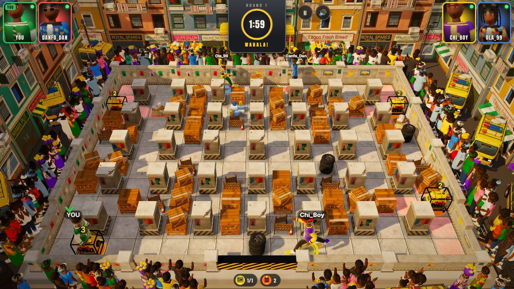 | 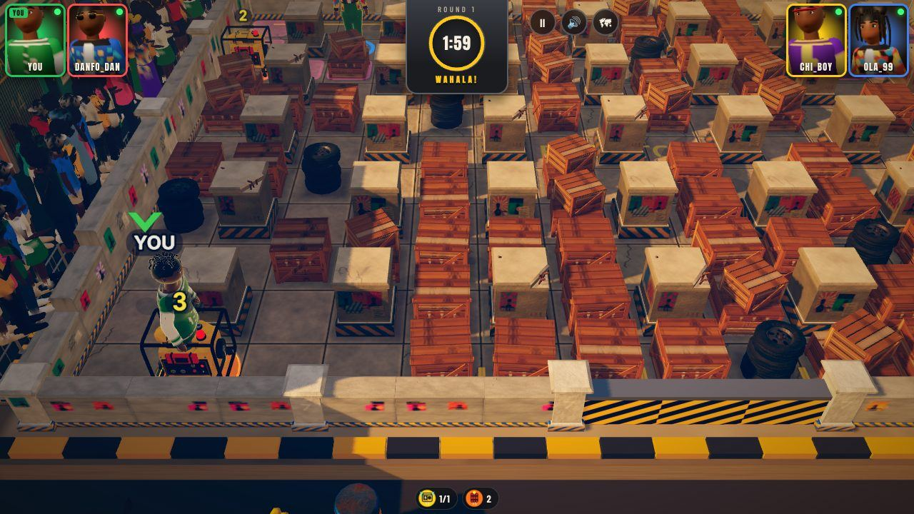 |
| Balogun Market, desktop | 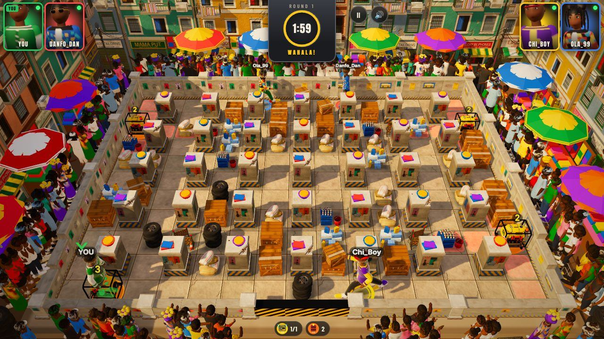 | 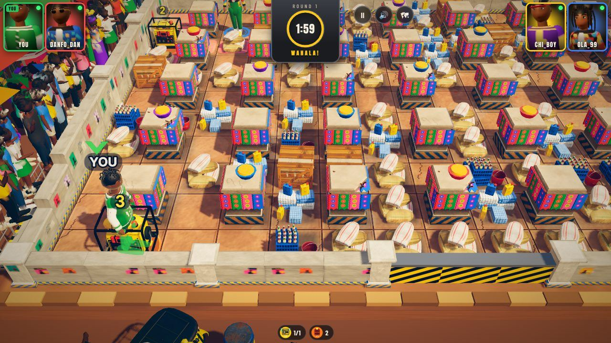 |
| Lekki Roadworks, desktop | 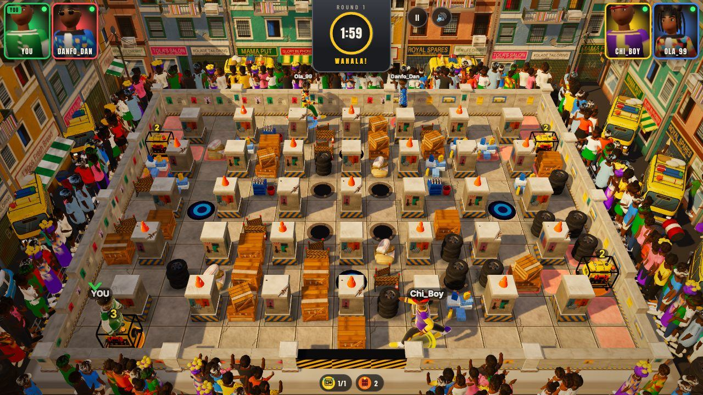 | 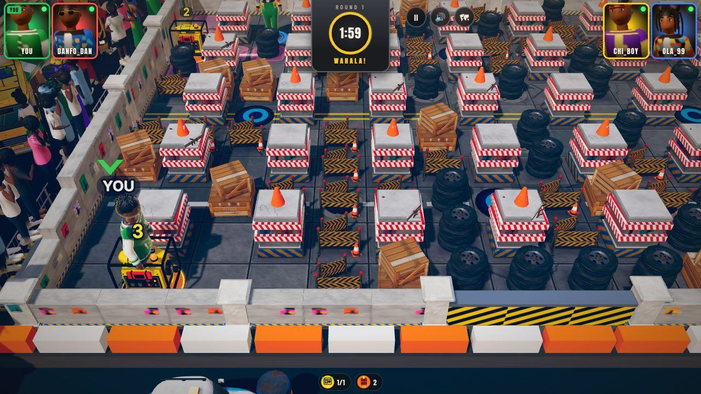 |
| Danfo Bus Park, phone | 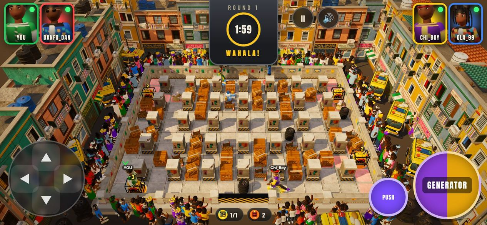 | 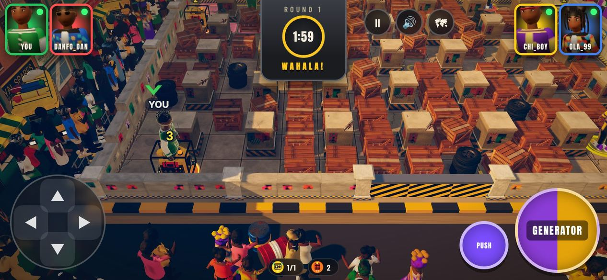 |
| Balogun Market, phone | 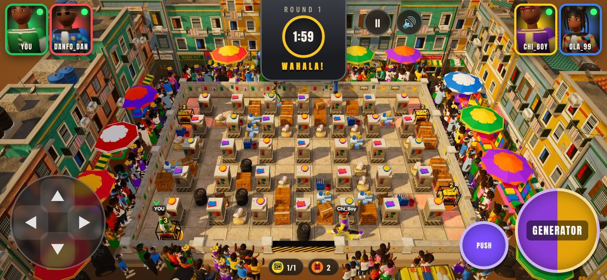 | 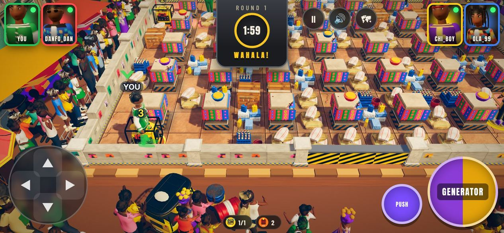 |
| Lekki Roadworks, phone | 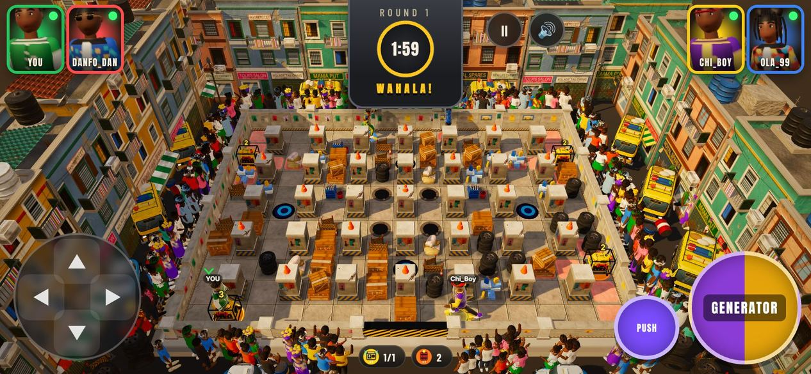 | 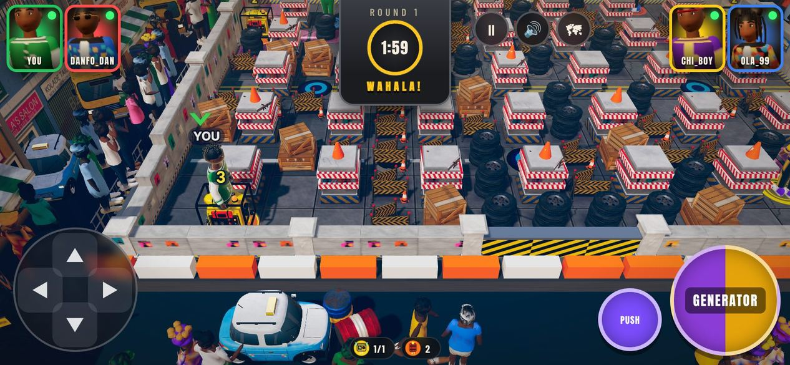 |

Note: the "before" frames were rendered with the WIP's accidental `softDensity` 0.38, so they show fewer crates than real matches; the "after" frames use the restored 0.62.

Screenshot locations (`docs/screenshots/camera-overhaul/`):

- `before/<arena>-<desktop|mobile>-{0-countdown,1-running,2-blast}.jpg` - baseline at `3c4c4b4`.
- `after/<arena>-<desktop|mobile>-0-countdown.jpg` - the establishing overview at the start of the countdown.
- `after/...-1-running.jpg` - action camera on the local player in the spawn corner after placing a generator.
- `after/...-2-blast.jpg` - bots' generators going off.
- `after/...-3-north.jpg` - the local player moved by the debug hook to the north side (staged position) to show the far backdrop; a bot may overlap the player in these frames.
- `after/...-4-overview.jpg` - the whole-arena view after pressing `O`.
- `after/...-5-entry.jpg`, `...-6-vehicle.jpg` - choosing a vehicle entrance (automatic overview) and the action camera keeping the launched Danfo/taxi/Keke in frame.

## Camera (the main change)

| | Before (WIP `3c4c4b4`) | After: action camera (default) | After: overview (`O` / map button) |
| --- | --- | --- | --- |
| Pitch above the floor | 43 deg | **41 deg** | 48 deg |
| Vertical FOV | 40 deg | 38 deg (52 portrait) | 38 deg |
| Distance to look-at point, desktop | ~18.5 | **10.9** | 20.5 |
| Camera height, desktop | 12.6 | **7.2** | 15.2 |
| Distance / height, phone | ~22.2 / 15.2 | 11.1 / 7.3 | 22.6 / 16.8 |
| Framing | whole board fitted, fixed | ~9 tiles across at the player's row, follows the local player | whole board fitted |

- The camera is 43% lower and 41% closer; characters are about 1.6-1.8 times taller on screen even though they are drawn slightly smaller in the world (1.86 instead of the WIP's 2.02 tiles).
- **Follow**: the look-at point tracks the local player (plus a 0.55-tile lead in the running direction) with critically-damped smoothing (0.3 s position, 0.55 s zoom, 0.45 s pitch). It never rotates, so up is always north and the controls keep their meaning. The player sits slightly below the centre of the HUD-free band so more of the lanes ahead are visible.
- **Bounded**: the view may show at most ~1.8 tiles of street beyond the side walls and ~1.1 beyond the south wall (3.4 / 2.2 on phones, so a player in a corner never stands under the D-pad or the action buttons - unit-tested for every open tile).
- **Fairness**: it widens only as far as needed to keep in frame every live generator whose cross can reach the player, every vehicle about to pass within two tiles, and the player's own vehicle while it drives (`cameraDirector.ts`).
- **Shots**: establishing overview for the first half of the countdown, then a glide down to the player; overview while choosing a vehicle entrance (all border arrows visible and clickable); survivors framed when the local player is out; a close-up of the winner at the end (0.72 x distance); overview on a draw.
- **Overview toggle**: `O` key or the new map/camera button beside pause and mute; the choice is saved with the other settings.
- Screen shake is scaled down when the camera is close so it never becomes disorienting.

## Scene composition and visual hierarchy

- Obstacles are squat and chunky: pillars ~0.92 m, soft blocks ~0.6 m (footprints, positions and collision unchanged). Characters are now the tallest thing on the board; pillars no longer hide the lane behind them under the low camera.
- Obstacle and floor materials are tinted per arena to sit a step behind the characters; spectators are smaller (0.76-0.84 scale), a step darker and pushed back from the walls; the north rail crowd is thinner (more people line the side walkways), the south street keeps only a thin foreground row.
- Each arena draws its breakables from a small coherent family instead of the full mix (bus park: crates + tyres; market: produce sacks, sachet water, drink crates; roadworks: barricades, tyres, site crates). Which model draws a block is visual only.
- A low kerb/barrier line outside the south wall forms the foreground edge of the action view; the gate cap is steel grey instead of a black slab.

## Arenas

| Arena | Light and atmosphere | Board | Surroundings |
| --- | --- | --- | --- |
| Danfo Bus Park | golden late-afternoon sun low in the west, warm dust haze, long shadows | warm concrete slabs with yellow bay lines, a stencilled BUS STOP and oil drips; poster pillars; crates and tyre stacks | Danfo fleet, OJUELEGBA shelter, shophouses, yellow/black kerb |
| Balogun Market | high tropical midday sun from the east, bright saturated colour | terracotta floor with dust and spilled produce; pillars wrapped in Ankara cloth like stall posts (scalloped hem), occasional enamel basins; sacks, sachet water, drink crates | stalls and umbrellas (Gemini), new Ankara bunting along the walls, corrugated canopies over the side walkways, clay kerb |
| Lekki Roadworks | cool blue-hour light, blue fog and street, higher reflections | dark patched asphalt with tar seams, white lane dashes and a double yellow line; pillars banded with red/white reflective chevrons and cones; barricades and tyres | half-built three-storey concrete frame with rebar, tower crane, excavator, sand/gravel heaps and pipes, floodlight masts with glow, a lit glass-tower skyline in the fog, orange/white water barriers; thinner crowd |

The Gemini-built pieces (GLB pillars, walls, props, vehicles, crowd, buildings, market stalls and umbrellas, roadworks gantry sign, OJUELEGBA shelter, floor textures, pillar-top accents) are all kept and reused.

## Characters

- Drawn at 1.86 tiles (WIP 2.02) but much larger on screen thanks to the camera; faces, outfits and the Run/Place/Ride clips read clearly.
- A small dust scuff when a running character turns sells direction changes; the Okada shield bubble, elimination puffs, occlusion silhouettes, slot rings and contact shadows from earlier passes are unchanged and now seen up close.

## Rendering and lighting

- Per-arena sun (colour, strength, direction), hemisphere fill, environment-reflection strength, exposure, sky and distance fog (`arenaLook.ts`); the fog now starts 15-17 units out, so the backdrop recedes behind the arena (atmospheric depth) while the arena itself stays crisp.
- Grade: a cinematic split tone (cool teal shadows, warm highlights) added to the existing tone-mapping grade - zero extra passes. Slightly stronger CSS vignette.
- Flames: arm and core sprites are 20-25% lower so a blast under the low camera no longer hides the lane behind it; floor glow, the plus-shaped tile glow and flame lights are unchanged.
- Cost at medium quality (Chromium/SwiftShader, same seed, after 200 ticks): draw calls 210/370/386 -> 206/352/404 and triangles 0.94M/0.97M/1.02M -> 0.89M/0.94M/0.89M for bus park/market/roadworks. The high-quality crowd budget is 230 (was 320), medium 130 (was 170).

## Gemini audit (`3c4c4b4` vs `9db37bd`)

| WIP change | Outcome |
| --- | --- |
| `src/sim/config.ts`: `pickups.hiddenChance` 0.4 -> 0.58, `arena.softDensity` 0.62 -> 0.38 | **Reverted** (gameplay economy and pacing). The simulation is now identical to `9db37bd`. |
| Camera pitch 43 deg / FOV 40 / fit tweaks | Superseded by the new action camera; the fit algorithm lives on as the overview. |
| Character height 2.02, rim light, labels, rings, badges and markers raised | Kept, except height 1.86 (see above). |
| Pillar scale (0.84, 1.08, 0.84), soft scale, accents raised | Replaced by squat proportions; accents follow the new pillar top. |
| Flames: beam, white cross, bigger sprites | Kept, sprites lowered 20-25%. |
| Generator pedestal, pickups, vehicle scale 1.32, grading, lighting, textures, rebuilt pillar/wall/floor assets | Kept. |

## Verification

- `npm run check`: typecheck, ESLint, **457 Vitest tests passed** (35 files), production build OK.
- `src/sim`, `src/ai`, `src/input`, `src/audio` and `public/` are byte-identical to `9db37bd` (the WIP's two config edits reverted), so movement, one-tile input, generators, blasts, vehicles, Okada, match timing and Wahala Crush (warning at 0:45, final collapse at 0:00, `tests/crush-schedule.test.ts`) are unchanged by construction and by their existing tests.
- New unit tests (`tests/render/camera.test.ts`): overview keeps every tile on screen with exact picking on desktop, phone and portrait; the action camera is 40-50 deg, closer than 0.65 x the overview and under 8 m high; the local player (feet and head) stays inside the HUD-free band from every open tile on all three viewports, never under the phone controls, with exact picking; a reaching generator widens the frame; motion is damped; director rules (countdown, overview preference, spectating, winner close-up, own vehicle, ignored threats).
- New e2e test (`gameplay camera`): the action camera is 40-50 deg; `O` and the HUD button toggle the overview and back without touching the match. Passes on desktop and phone.
- Playwright e2e, both projects, one worker: E2E_RESULT
- Real-browser screenshots of all three arenas on desktop and phone (this document).

## Known limitations

- Software WebGL in this container renders a few frames per second, so the damped camera motion was verified by unit tests and the screenshot frames, not watched at 60 fps on a real phone. The screenshot script cuts the camera to its goal before each frame for that reason.
- The board is still dense: `softDensity` is a gameplay number and stays 0.62. The treatment (lower props, coherent families, tints) reduces clutter but the field is still mostly obstacles at the start of a match.
- Lekki "blue hour" is a lighting treatment of the same shophouse side streets; only its north side (site, crane, skyline) is unique geometry. The market and bus park share the Gemini building and crowd models.
- The overview remains the right view for players who want the whole board at once; the action camera can still leave far corners off screen when nothing threatens the player there (by design).
- The Bible's camera wording (sections 1 and 12) is superseded by the founder directive, recorded as `DECISIONS.md` C1-C4; the Bible text itself was not edited.
