# Gritty gameplay v1 - report

Branch `claude/wahala-gritty-gameplay-v1`, started from `a734ef8` (`claude/wahala-camera-overhaul`). Decisions
G1-G11 in `DECISIONS.md`; audio details in `AUDIO.md`.

All screenshots are real gameplay rendered by the game in Chromium (software WebGL, `?q=high&seed=7`, four
competitors), captured with `scripts/gameplay-shots.mjs` (the same script, seed and steps for before and after) and
`scripts/quick-shot.mjs`. Desktop is 1280x720; phone is an 844x390 landscape phone with the touch controls.

## Before and after

`0-countdown` frames are the whole-arena view in both versions (comparable framing). In the `1-running` / `2-blast`
frames the "before" build used the old close follow camera; the "after" build keeps the whole arena on screen for
the whole match (that is the camera correction itself).

| | Before (`a734ef8`) | After |
| --- | --- | --- |
| Danfo Bus Park, desktop | 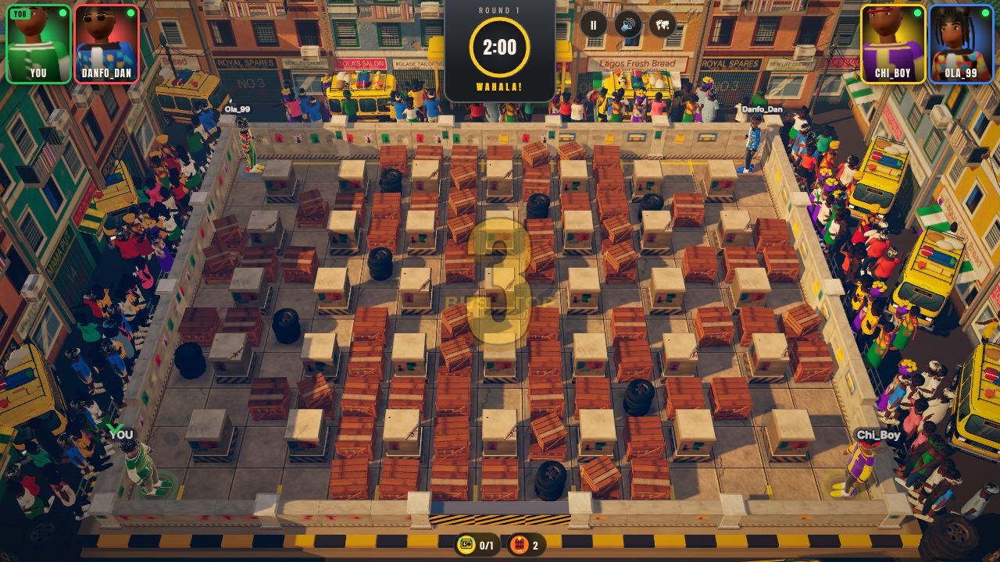 | 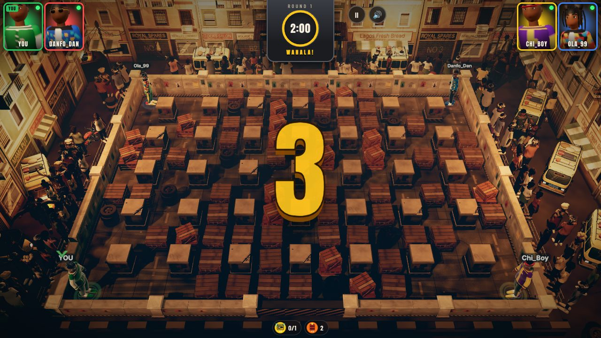 |
| Danfo Bus Park, blast | 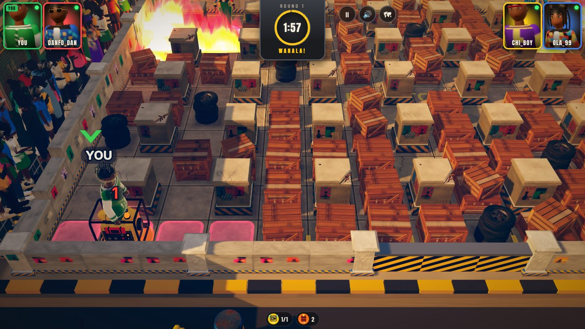 | 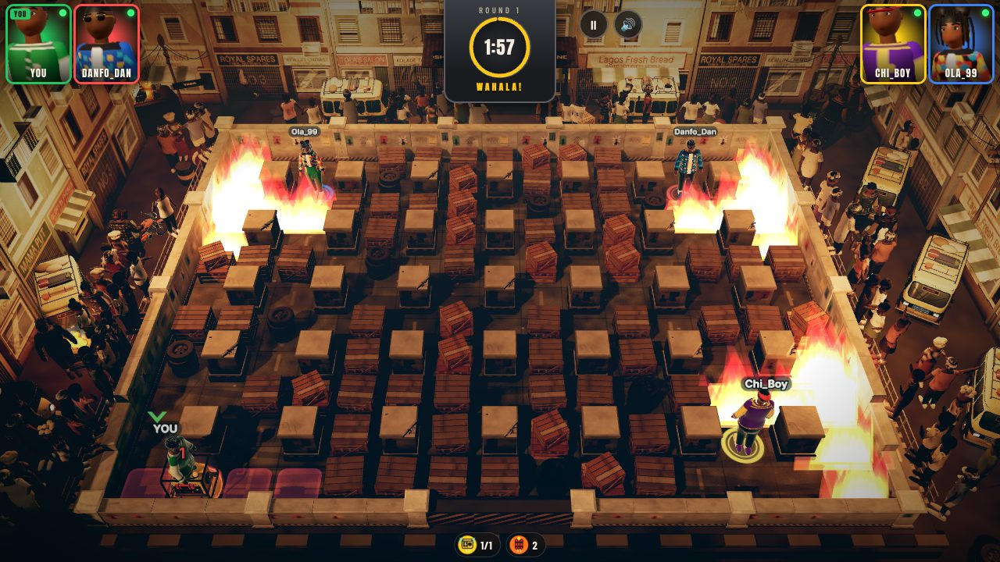 |
| Balogun Market, desktop | 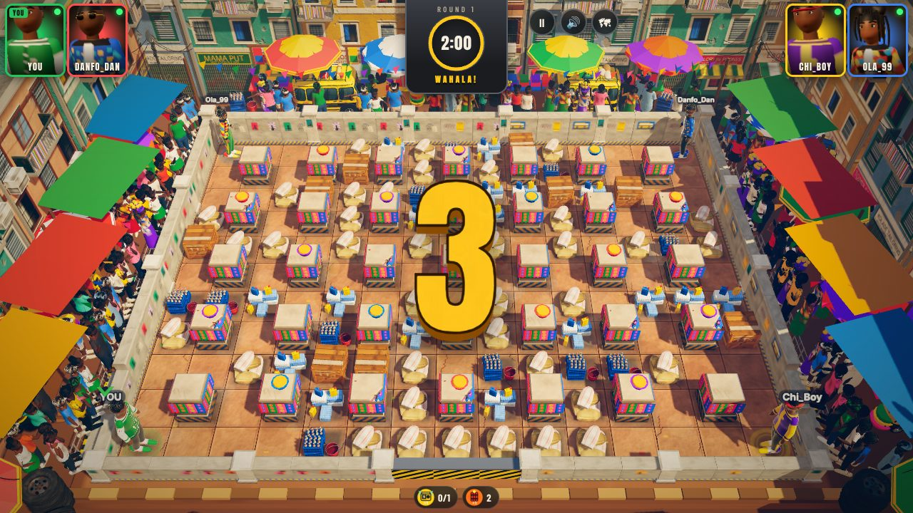 | 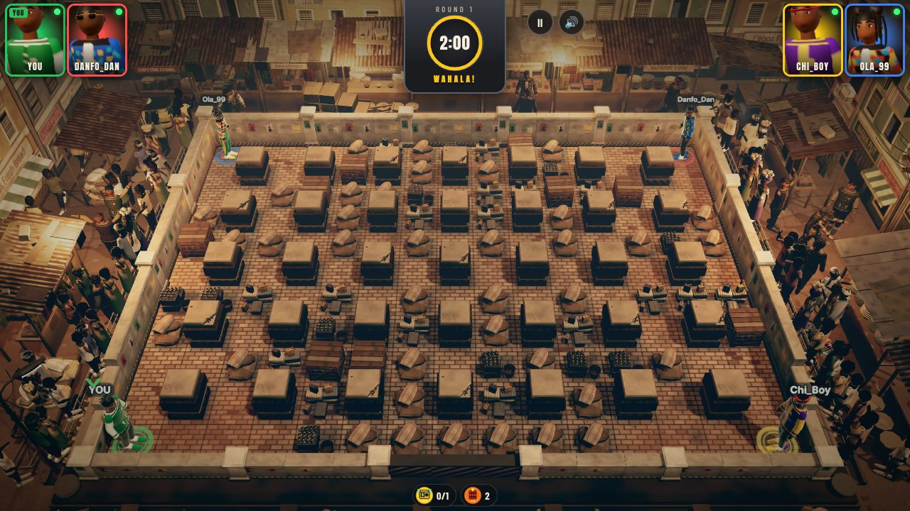 |
| Balogun Market, blast | 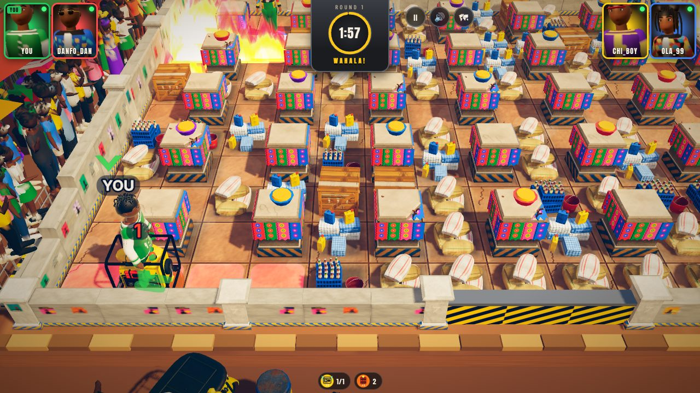 | 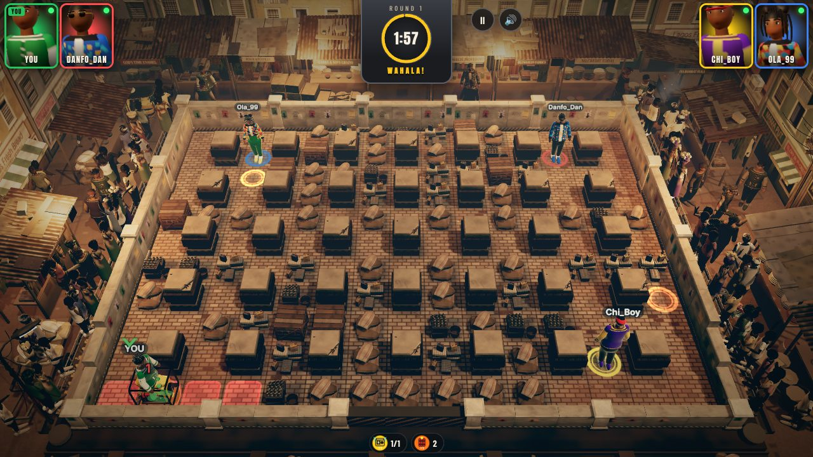 |
| Lekki Roadworks, desktop | 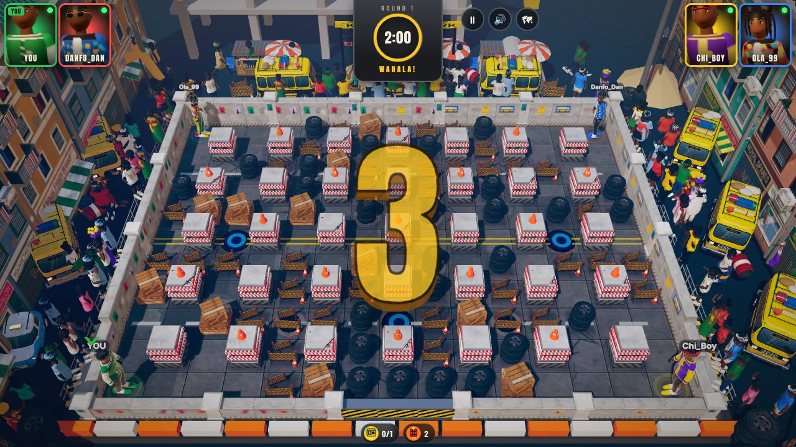 | 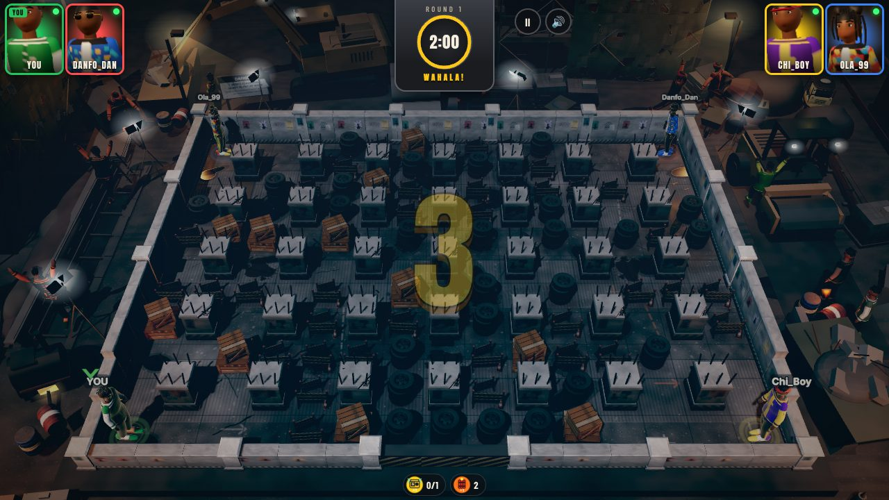 |
| Lekki Roadworks, blast | 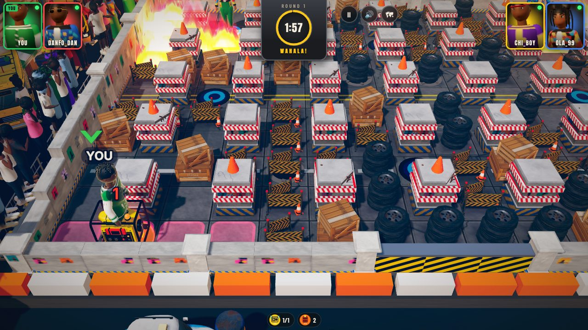 | 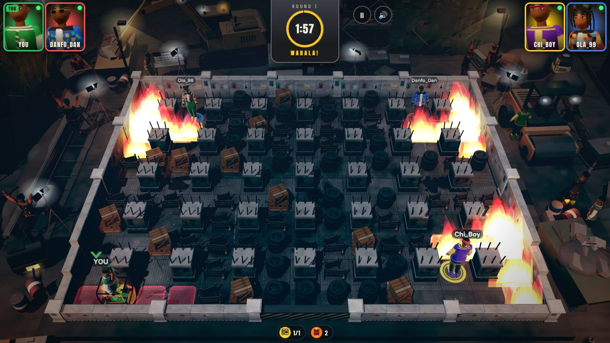 |
| Danfo Bus Park, phone | 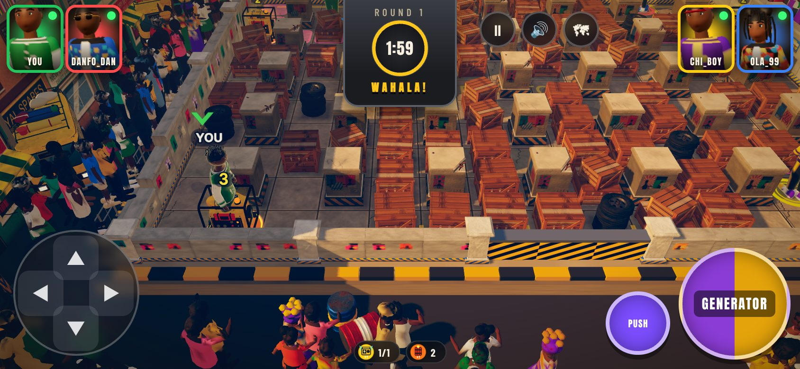 | 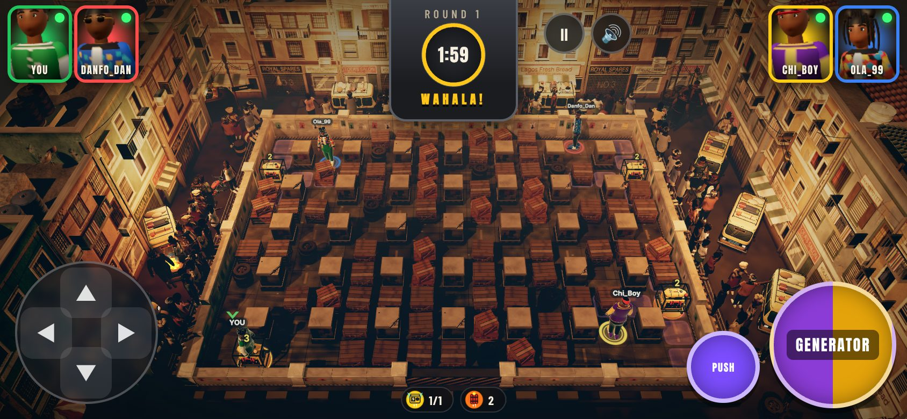 |
| Balogun Market, phone | 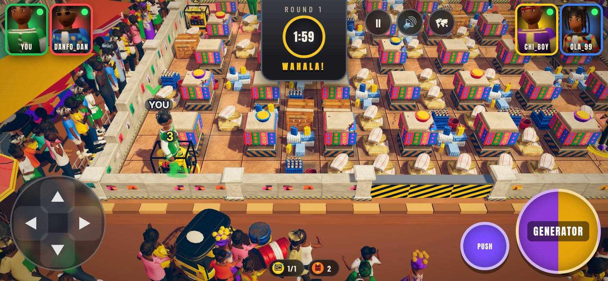 | 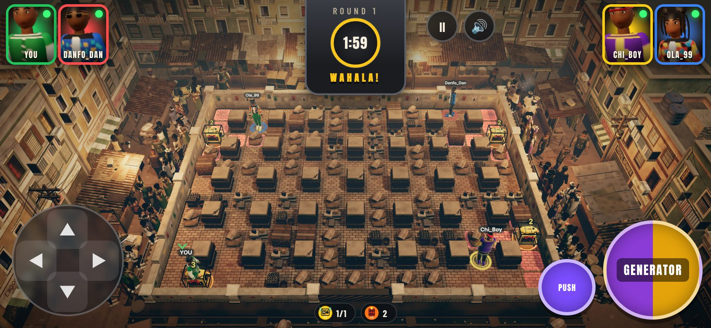 |
| Lekki Roadworks, phone | 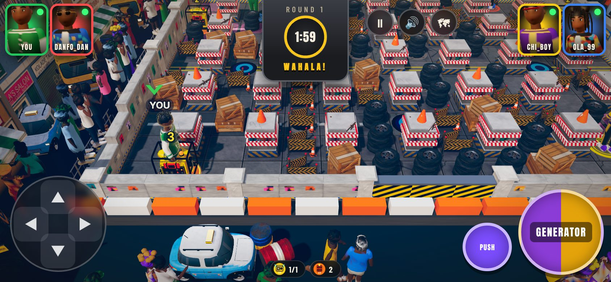 | 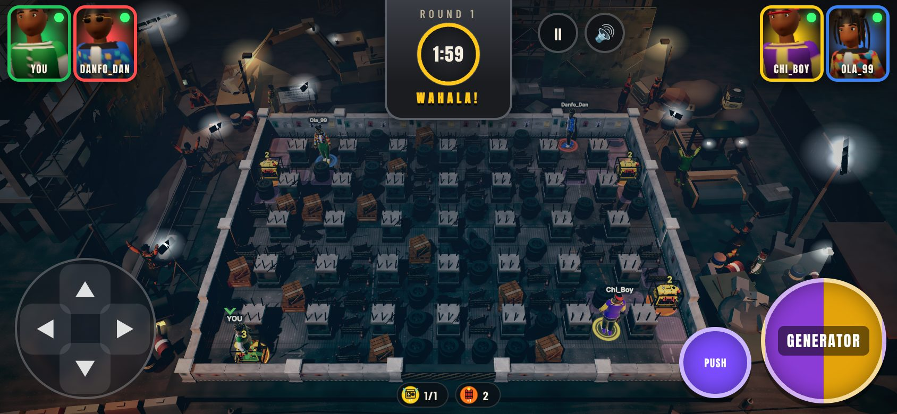 |

All frames: `docs/screenshots/gritty-v1/{before,after}/<arena>-<desktop|mobile>-{0-countdown,1-running,2-blast}.jpg`;
close-ups in `docs/screenshots/gritty-v1/detail/`.

## Camera

- **Standard matches (2-4 players): one shared screen, whole arena, always.** A fixed cinematic three-quarter camera at
  46 degrees, fitted so every tile (and a standing character on the far row) is inside the HUD-free band and the near
  corners stay clear of the phone D-pad and buttons. It never follows anybody or zooms on survivors or the winner; the
  `O` key and the map button are hidden. Unit-tested on desktop, landscape phone and portrait (pitch 40-50 degrees,
  whole arena in view after 10 simulated seconds), director-tested for countdown / play / threats / spectating /
  entry / results, and e2e-tested in Chromium (mode `arena`, arena in view after moving, pressing `O` and spectating).
- **Stadium mode**: the previous close follow camera (with its overview toggle) is kept as the reusable `stadium`
  mode for the future 32-player stadium arena. No arena uses it; `?cam=stadium` forces it (e2e-tested).

## Visual transformation

- **Weathering everywhere (`render/grit.ts`)**: every lit material is patched: colour (after textures, vertex and
  instance colours) is pulled to a dusty, desaturated tone; world-space grime and soot mottling; street dirt creeping
  up from the ground; dust on upward faces; more roughness. Per class: scenery, floor, vehicles, crowd, players, skin.
- **Grade and light**: firm S-curve, crushed blacks, mild bleach bypass, teal/amber split tone, heavy vignette.
  Bus park: smoggy late afternoon with sodium street lamps. Market: hazy overcast noon with bare bulbs under the
  stalls. Lekki: night shift under cold floodlights and work lamps (lamps are skipped on low quality, which gets a
  stronger fill instead).
- **Playfield floors** (procedural, per arena): worn bus-park tarmac with faded bay paint, oil stains, tyre smears,
  patches and litter; broken market pavers with red laterite, palm-oil stains and refuse; wet, cracked, milled
  roadworks asphalt with cement patches, puddles (glossy in the roughness map) and survey paint. Faint tile seams keep
  the grid readable. The toy pillar accents (traffic cones, bright ankara wraps, basins) are gone: rusted sheet-iron
  collars in the market, rebar stubs on the unfinished roadworks columns.
- **Explosions**: heavier black smoke billow, flying grit and metal, soot-splash scorch marks that stay for most of
  the match, on top of the existing fire crosses, flash, shockwave and shake.
- **Characters**: adult head proportions in play (head bone x0.82 after the animation pose), rougher, grimier
  clothing; slot colours, rings and labels keep every competitor identifiable.

## Three different arenas (`render/arenas/`)

| Arena | Surroundings |
| --- | --- |
| Danfo Bus Park | A rough terminal: Danfos nosed into worn bays under a rusted corrugated shelter with faded route boards (OSHODI / OJOTA, CMS / OBALENDE, YABA), an echelon of Danfos on the east street, kekes and okadas waiting for fares, a burnt-out Danfo smouldering in the north-west corner, burning tyres, a tyre seller's stacks, oil drums, shophouses on three sides, exhaust and dust. |
| Balogun Market | A dense trading district: a continuous row of metal stalls under rusted corrugated sheets and patched tarpaulins with faded signboards; dyed cloth, enamel basins, open grain sacks, provisions; push-trucks and wheelbarrows; open gutters with plank bridges; a buka with a pot on three stones and wood smoke; shophouses pressing in on narrow lanes; low produce mats on the camera side. |
| Lekki Roadworks | A night-shift construction zone: an excavator (tracks, cab with lamps, boom, stick, bucket, beacon) tipping into a skip, a tower crane, two half-built concrete frames with rebar and formwork, scaffolds with torn debris netting, site hoarding and a danger board, shored trenches with spoil heaps, a roller on steaming asphalt, a concrete mixer, a generator set, a tar boiler, floodlight masts, tripod work lights and a flickering welder's arc, the Lekki skyline behind. No shops, no spectator stands. |

Close-ups: `detail/buspark-north-terminal.jpg`, `detail/market-north-stalls.jpg`, `detail/market-east-lane-fight.jpg`,
`detail/roadworks-excavator.jpg`, `detail/roadworks-trench-crew.jpg`.

## Living background (`render/life/StreetLife.ts`, `render/fx/Ambient.ts`)

Real skinned, animated characters (the cast rigs re-dressed in muted work clothes, so nobody resembles a player)
act out small scenes on randomised timings so nothing loops in sync: fistfights (shoves, kicks, stumbles, circling,
one backing off), arguments, conductors waving passengers in and pacing beside their buses, sellers handing goods
over while customers bargain, hi-vis workers digging, stamping and hauling, onlookers cheering when the match gets
loud, walkers. Capped at 16 / 10 / 4 actors (high / medium / low). The static spectator crowd is thinned where the
street has its own business and removed entirely from the construction site. Burning tyres, the wreck, cooking
fires, exhaust and dust are three particle draw calls. Nothing stands on the board.

## Background vehicles

Every parked or background Danfo, taxi, keke and okada is the detailed GLB model at the gameplay scale (1.32),
instanced; idling ones puff exhaust; the wreck is the same Danfo model with charred materials. The wall variant
with a flat painted cartoon Danfo mural (`env_wall_d`) is no longer used, so there are no cheap flat buses next to
the modelled ones.

## Mandatory endgame floor traps

- Every standard match, every arena, both modes: at 0:31.5 a symmetric wave of potholes and oil slicks is
  telegraphed (strobing amber/violet tiles with a closing ring, an alarm, a "FINAL 30s: FLOOR TRAPS!" toast); at
  exactly 0:30 it goes live (the floor gives way: a jolt and grit); a second wave at 0:15. No setting can turn them
  off. Live traps keep a pulsing amber ring so they never read as ordinary oil stains.
- They genuinely work (a pothole stumbles you, oil slides you two tiles) and are fair: only a step that starts onto a
  live trap triggers it; a wave only claims open floor (never a trap hidden under a crate); never on pillars; in
  Wahala Crush never on the final safe tile or its neighbours; crushed tiles bury their trap.
- The old option is now "Early traps" (traps all match, on top of the endgame waves), available on every arena.
- Wahala Crush is unchanged and re-tested with the traps: warning at 0:45, first landing at 0:43.8, final tile at
  exactly 0:00, simultaneous final deaths = draw. Match duration, crate density and pickup odds are unchanged.

## Music

Nine of the founder's ten approved Pixabay tracks are installed and play (the tenth, #7 `pixabay_496406`, was not
supplied; its slot is ready). Each arena has its own three tracks and starting track, rotation never repeats a
track back to back, and from 0:30 the soundtrack accelerates with pitch preserved (1.00 -> 1.045 at 0:15 -> 1.09 at
0:00) with a brightness lift and compensating trim, dipping under the trap alarms. Details, credits, loudness and
licence handling in `AUDIO.md` and `public/audio/LICENSES.md`.

## Verification

See `IMPLEMENTATION_STATUS.md` ("Gritty gameplay v1") for the exact commands and results.

## Known limitations

- Software WebGL in this container renders a few frames per second: animation timing, NPC behaviour and music were
  checked through tests, debug state and still frames, not watched at 60 fps on a real phone.
- Nobody has listened to the music in this environment (no audio output); levels and the endgame lift are measured,
  not judged by ear.
- The board stays dense at the start of a match (`softDensity` is a gameplay number and was not changed).
- The cast GLBs themselves (faces, clothing geometry) were not remodelled; the maturity comes from proportions,
  materials, light and grade. A full character remodel would be the next step for an even more grounded cast.
- Side-street activity is small at the whole-arena framing; it reads clearly on larger screens and in close-ups.
